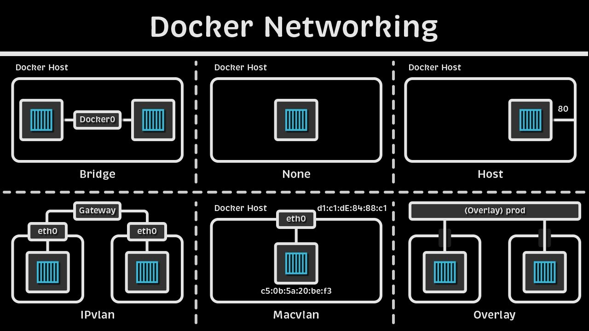

# Inception
## Preparar los directorios  

```
inception/  
├── Makefile  
├── secrets/  
│   ├── db_password.txt  
│   └── db_root_password.txt  
└── srcs/  
    ├── docker-compose.yml  
    ├── .env  
    └── requirements/  
        ├── mariadb/  
        │   ├── Dockerfile  
        │   ├── conf/  
        │   └── tools/  
        ├── nginx/  
        │   ├── Dockerfile  
        │   ├── conf/  
        │   └── tools/  
        └── wordpress/  
            ├── Dockerfile  
            ├── conf/  
            └── tools/  
```
Comando para facilitar la vida, gracias
```sh
mkdir -p inception/{secrets,srcs/requirements/{mariadb/{conf,tools},nginx/{conf,tools},wordpress/{conf,tools}}} \
&& touch inception/Makefile inception/secrets/{db_password.txt,db_root_password.txt} inception/srcs/{docker-compose.yml,.env} inception/srcs/requirements/{mariadb,nginx,wordpress}/{Dockerfile,.dockerignore}
```

## Instalar Docker

```sh
# Add Docker's official GPG key:
sudo apt update
sudo apt install ca-certificates curl
sudo install -m 0755 -d /etc/apt/keyrings
sudo curl -fsSL https://download.docker.com/linux/debian/gpg -o /etc/apt/keyrings/docker.asc
sudo chmod a+r /etc/apt/keyrings/docker.asc

# Add the repository to Apt sources:
sudo tee /etc/apt/sources.list.d/docker.sources <<EOF
Types: deb
URIs: https://download.docker.com/linux/debian
Suites: $(. /etc/os-release && echo "$VERSION_CODENAME")
Components: stable
Signed-By: /etc/apt/keyrings/docker.asc
EOF

sudo apt update

# Install the Docker packages
sudo apt install docker-ce docker-ce-cli containerd.io docker-buildx-plugin docker-compose-plugin
```
  
Ejecutar `docker run hello-world` para ver si funciona  
  
```sh
# List images
docker images

# List running containers
docker ps

# List all containers (including stopped)
docker ps -a
```
  
**How Docker and docker compose work** 

**Docker** es un software con el que puedes crear mini máquinas virtuales (solo a nivel de app) llamados contenedores.  
  
Los **contenedores** contienen todo lo necesario (las dependencias en su versión correcta, las variables de entorno necesarias…) para correr la app.  
  
Para correr las apps en los contenedores, necesitas un ejecutable con todas las dependencias, el programa y tal. Y para compilar el ejecutable, llamado **imagen**, tenemos que hacer un Dockerfile.   
  
```sh
# Comandos relevantes
docker build
docker run

# Ejemplo
docker run -d -p 8080:80 --name my-nginx nginx
# -d: detached, corre en segundo plano
# -p: puerto público:privado
```
  
**Docker-compose** es una herramienta para correr varios contenedores de manera más rápida (de lo contrario, habría que correr `docker build` y `docker compose` para cada aplicación. Se aplica el comando `docker-compose` sobre un archivo .yml. YAML es [whitespace-sensitive y no acepta tabs](https://fixed.docs.upsun.com/learn/overview/yaml/what-is-yaml.html). 

La plantilla del docker-compose de este proyecto (no todos los campos son necesarios):

```yml
services:
  mariadb: 
    build: # para hacer que docker-compose buildee la imagen antes de correr
      context: # el dockerfile suele estar aquí, solo basta poner esto; si no, se usa para buscar sus archivos dependientes
      dockerfile: # el dockerfile
    image: #formato: imagen:versión
    ports:
      #- "público:privado"
    container_name: 
    depends_on:
      #- wordpress
    networks:
    volumes: # Si quieres que los datos persistan incluso cuando el contenedor no está corriendo
      - mariadb_data:/var/lib/mysql #nombre:dónde
    env_file: #alternativa para usar env (${VAR}): "environment:"
      .env
    secrets:
      #-db_passwords
    restart: on-failure 

volumes: 
  mariadb_data: #nombre del volumen
    driver: # tipo de volumen
    driver_opts: # opciones avancadas de lo de arriba
      type: 
      o: 
      device: 

secrets: # Docker tiene su propio gestor de contraseñas e información sensible
  #db_passwords:
    #file: .txt
```

* [Infomación sobre restart](https://github.com/compose-spec/compose-spec/blob/main/spec.md#restart)

**The benefit of Docker compared to VMs**  

| Aspect         | Docker Containers    | Virtual Machines    |
| -------------- | -------------------- | ------------------- |
| Resource Usage | Share host OS kernel | Each VM has full OS |
| Startup Time   | Seconds              | Minutes             |
| Memory         | MB                   | GB                  |
  
Por ejemplo, si en una máquina virtual quisieras correr un software que necesita Python 3.14 y otro que necesita Python 3.12, lo corres cada uno en su docker con sus dependencias correspondientes y no se matan entre sí.  

## Docker network

Para conectar contenedores entre sí, requerimos que estén en la misma network. Docker, como añade un nivel de abstracción y tal, tiene tipos de network dependiendo de lo que queramos:
* **Bridge**: A bridge network is the **default network type** when you install Docker. It allows containers to communicate with each other and the host machine, but provides no access to the outside world, aunque se puede conseguir mediante NAT (traducción de red). Red privada virtual
* **Host**: A host network uses the host machine's network stack and provides no isolation between the host and the container. Es decir, usa los puertos del host como si fueran propios
* **Overlay**: An overlay network allows containers running on different Docker hosts to communicate with each other.
* **Macvlan**: A Macvlan network allows a container to have its own IP address (y MAC, es decir, funciona como si fuera una máquina independiente) on the same subnet as the host machine

Crearemos nuestro custom network (que es del tipo bridged) porque
1. Los contenedores solo se comunican mediante la dirección IP (podemos hacerlo por nombres)
2. No hay Dynamic Name System, es decir, si asociamos un nombre a una dirección IP, cuando cambie, este no cambiará la IP asociada
3. Menos seguro en general porque están todos los contenedores amontonados en una misma red

SO...
```sh
# Create a custom network
docker network create inception-network

# List networks
docker network ls

# Inspect the network
docker network inspect inception-network
```

Y como los contenedores van a estar en esa network, lo declaramos en nuestro docker-compose.yml.

```yml
networks:
  inception-network:
    driver: bridge
```


## Wordpress

Wordpress es un sistema escrito en PHP que se usa junto a MySQL o MariaDB para hacer cosas en la web, principalmente páginas web, newsletters, foros, LMS, tiendas y así.

Los requisitos para correr Wordpress:
* PHP 8.3 or greater
* MariaDB 10.6 or greater OR MySQL 8.0 or greater
* Nginx or Apache with mod_rewrite module
* HTTPS support

So yeah, al parecer estamos haciendo todo esto para hacer web-server.

**Dockerfile**
```Dockerfile
FROM debian:bookworm

RUN apt update && apt install -y \
    php-fpm \ 
    php-mysql \
    curl \
    wget \
    unzip \

RUN ln -s /usr/sbin/php-fpm8.4 /usr/local/bin/php-fpm

# Create WordPress directory
RUN mkdir -p /var/www/html
WORKDIR /var/www/html
RUN chown -R www-data:www-data /var/www/html

EXPOSE 9000

COPY conf/www.conf /etc/php/8.2/fpm/pool.d/
COPY tools/wordpress.sh /usr/local/bin/


RUN chmod +x /usr/local/bin/wordpress.sh

ENTRYPOINT [ "/usr/local/bin/wordpress.sh" ]

CMD ["php-fpm8.4", "-F"]
```

**Configuration file**
```conf
[www]
user = www-data
group = www-data
listen = 9000
listen.owner = www-data
listen.group = www-data
pm = dynamic
pm.max_children = 5
pm.start_servers = 2
pm.min_spare_servers = 1
pm.max_spare_servers = 3
```

**Initialization script**
```sh
#!/bin/bash
set -e

cd /var/www/html

# Secretos
if [ -f "$MYSQL_PASSWORD_FILE" ]; then
    MYSQL_PASSWORD=$(cat "$MYSQL_PASSWORD_FILE")
fi

# Descargar WordPress tal cuál te dice su página: https://developer.wordpress.org/advanced-administration/before-install/howto-install/
if [ ! -f wp-config.php ]; then
    echo "WordPress: Downloading..."

    wget https://wordpress.org/latest.tar.gz
    tar -xzf latest.tar.gz
    mv wordpress/* .
    rm -rf wordpress latest.tar.gz

    echo "WordPress: Configuring..."

    cp wp-config-sample.php wp-config.php

    sed -i "s/database_name_here/${MYSQL_DATABASE}/" wp-config.php
    sed -i "s/username_here/${MYSQL_USER}/" wp-config.php
    sed -i "s/password_here/${MYSQL_PASSWORD}/" wp-config.php
    sed -i "s/localhost/${MYSQL_HOST}/" wp-config.php

    chown -R www-data:www-data /var/www/html
fi

# Esperar a MariaDB
until mysqladmin ping -hmariadb --silent; do
    echo "Waiting for MariaDB..."
    sleep 2
done

echo "WordPress: Starting PHP-FPM..."
exec "$@"
```

**Actualizar el docker-compose**
```yaml
networks:
  inception-network:
    driver: bridge

services:
  mariadb:
    build: 
      context: requirements/mariadb
    container_name: mariadb
    networks:
      - inception-network
    volumes:
      - mariadb_data:/var/lib/mysql #montada allí
    env_file:
      - .env
    secrets:
      - db_root_password
      - db_password
    restart: always
  wordpress:
    build: requirements/wordpress
    container_name: wordpress
    depends_on:
      - mariadb
    networks:
      - inception-network
    volumes:
      - wordpress_data:/var/www/html
    env_file:
        - .env
    secrets:
      - db_password
    restart: always

volumes:
  mariadb_data:
    driver: local #almacenamiento local
    driver_opts:
      type: none
      o: bind # share a directory from the host's filesystem into the container
      device: /home/${USER}/data/mariadb # usa este sitio para guardar los datos
  wordpress_data:
    driver: local
    driver_opts:
      type: none
      o: bind
      device: /home/${USER}/data/wordpress

secrets: #esto luego se copia a la carpeta /run/secrets
  db_root_password:
    file: ../secrets/db_root_password.txt
  db_password:
    file: ../secrets/db_password.txt
```

**Actualizar el .env**

```env
MYSQL_DATABASE=wordpress
MYSQL_USER=wpuser
MYSQL_ROOT_PASSWORD_FILE=/run/secrets/db_root_password
MYSQL_PASSWORD_FILE=/run/secrets/db_password
MYSQL_HOST=mariadb
```

## Nginx
Nginx es:
* **Servidor web**: almacena los archivos de un sitio web (.html, .css, imágenes y así) y los envía a los usuarios a través de internet mediante el protocolo HTTP/HTTPS 
* **Reverse proxy**: es un servidor intermediario entre el cliente y los servidores internos; por ejemplo, si tienes muchos servidores de minecraft, puedes hacer que pasen todos tengan el mismo dominio (patata.serv1.com, patata.sev2.com...) y que el proxy se encargue de redirigirlos a su sitio correspondiente dentro de tu casa.
* **Almacenar caché**
* **Load balancing**: Distribuye eficientemente el tráfico entrante entre múltiples servidores backend
* **Protección ante ataques**: Con un proxy inverso instalado, un sitio o servicio web no necesita revelar nunca la dirección IP de su(s) servidor(es) de origen

Puedes configurar Nginx para que use distintos protocoles de red (SSL, y en nuestro caso, TLS)

TLS (**Transport Layer Security**) es un protocolo de seguridad de red. TLS works by using public key encryption to establish a secure connection between two parties. When a client wants to communicate with a server using TLS, the client and server exchange a series of messages to establish a secure connection. This process includes the exchange of digital certificates and the negotiation of encryption keys. Once the connection is established, the client and server can communicate securely over the internet.

Para implementar el TLS (también el SSL), se usa **OpenSSL**, que es gratis y open source.

**Dockerfile**
```Dockerfile
FROM debian:bookworm

# Corre comandos durante el proceso de build
RUN apt update
RUN apt install -y nginx openssl
RUN mkdir -p /etc/nginx/ssl

# Informa qué puerto está escuchando el contenedor cuando se ejecute
EXPOSE 443

# Copia los archivos y directorios de ARG1 a ARG2
COPY conf/nginx.conf /etc/nginx/nginx.conf
COPY tools/nginx_start.sh /usr/local/bin/

RUN chmod +x /usr/local/bin/nginx_start.sh

# Corre el ejecutable cuando inicia el contenedor
ENTRYPOINT [ "/usr/local/bin/nginx_start.sh" ]
```

Ahora, en `/nginx/tools` creamos el archivo `nginx_start.sh` para que genere el coso el certificado

**Initialization script**
```sh
#!/bin/bash

## Por si ocurre algún error
set -e

if [ ! -f /etc/ssl/certs/nginx.crt ]; then
    echo "Nginx: Generating self-signed SSL certificate"

    openssl req -x509 -nodes -days 365 -newkey rsa:2048 \
    -keyout /etc/ssl/private/nginx.key \
    -out /etc/ssl/certs/nginx.crt \
    -subj "/C=ES/ST=Bizkaia/L=Urduliz/O=42/CN=xwu.42.fr"

    chmod 600 /etc/nginx/ssl/nginx.key
    chmod 644 /etc/nginx/ssl/nginx.crt

    echo "Nginx: Certificate generated at /etc/nginx/ssl/"

else
    echo "Nginx: SSL certificate already exists"

fi

echo "Starting Nginx..."
exec nginx -g "daemon off;"
```

Explicación de la línea rara esta de `openssl req` , que genera el certificado:
* `-x509`: certificado autofirmado
* `-nodes`: no DES encryption, no hay contraseña
* `-days 365`: válido por 365 días
* `-newkey rsa:2048`: clave tipo rsa, 2048 bits
* `-keyout`: dónde guardar la clave privada (por eso solo el usuario tiene permisos 600)
* `-out`: dónde guardar el certificado público (644, just reading for others)
* `-subj`: información del certificado, `"/C=COUNTRY/ST=State/L=LOCALIDAD/O=Organization/CN=Domain_name"`

**Configuration file**
```ini
server {
    listen 443 ssl;
    listen [::]:443 ssl;
    server_name xwu.42.fr;

    ssl_certificate /etc/ssl/certs/nginx.crt;
    ssl_certificate_key /etc/ssl/private/nginx.key;
    ssl_protocols TLSv1.3;

    index index.php;
    root /var/www/html;
    location / {
        try_files $uri $uri/ /index.php$is_args$args;
    }
    location ~ \.php$ {
        try_files $uri =404;
        fastcgi_split_path_info ^(.+\.php)(/.+)$;
        fastcgi_pass wordpress:9000;
        fastcgi_index index.php;
        include fastcgi_params;
        fastcgi_param SCRIPT_FILENAME $document_root$fastcgi_script_name;
        fastcgi_param PATH_INFO $fastcgi_path_info;
        fastcgi_read_timeout 300;
    }
}
``` 

## Docker-compose

```yaml
networks:
  inception-network:
    driver: bridge

services:
  mariadb:
    build: 
      context: requirements/mariadb
    container_name: mariadb
    networks:
      - inception-network
    volumes:
      - mariadb_data:/var/lib/mysql #montada allí
    env_file:
      - .env
    secrets:
      - db_root_password
      - db_password
    restart: always
  wordpress:
    build: requirements/wordpress
    container_name: wordpress
    depends_on:
      - mariadb
    networks:
      - inception-network
    volumes:
      - wordpress_data:/var/www/html
    env_file:
        - .env
    secrets:
      - db_password
    restart: always
  nginx:
    build:
      context: requirements/nginx
    image: nginx:inception
    container_name: nginx
    depends_on:
      - wordpress
    networks:
      - inception-network
    volumes:
      - wordpress_data:/var/www/html
    environment:
      DOMAIN_NAME: ${DOMAIN_NAME}
    restart: always

volumes:
  mariadb_data:
    driver: local #almacenamiento local
    driver_opts:
      type: none
      o: bind # share a directory from the host's filesystem into the container
      device: /home/${USER}/data/mariadb # usa este sitio para guardar los datos
  wordpress_data:
    driver: local
    driver_opts:
      type: none
      o: bind
      device: /home/${USER}/data/wordpress

secrets: #esto luego se copia a la carpeta /run/secrets
  db_root_password:
    file: ../secrets/db_root_password.txt
  db_password:
    file: ../secrets/db_password.txt

```

## Makefile

```Makefile
# Variables
COMPOSE_FILE = srcs/docker-compose.yml
DATA_DIR = /home/$(USER)/data

.PHONY: all build up down clean fclean re

all: build up

# Create data directories
$(DATA_DIR)/mariadb:
    mkdir -p $(DATA_DIR)/mariadb
    sudo chown -R $USER:$USER /home/$USER/data/mariadb
    chmod 755 /home/$USER/data/mariadb

$(DATA_DIR)/wordpress:
    mkdir -p $(DATA_DIR)/wordpress
    sudo chown -R $USER:$USER /home/$USER/data/wordpress
    chmod 755 /home/$USER/data/wordpress

# Build images
build: $(DATA_DIR)/mariadb $(DATA_DIR)/wordpress
    docker compose -f $(COMPOSE_FILE) build

# Start services
up:
    docker compose -f $(COMPOSE_FILE) up -d

# Stop services
down:
    docker compose -f $(COMPOSE_FILE) down

# Clean containers and images
clean:
    docker compose -f $(COMPOSE_FILE) down
    docker system prune -af

# Full clean including volumes
fclean: clean
    docker volume prune -f
    sudo rm -rf $(DATA_DIR)

# Rebuild everything
re: fclean all
```


## Conceptos teóricos que aparecen

## Páginas de referencia
* https://docs.docker.com/get-started/docker-concepts/building-images/writing-a-dockerfile/

* https://dev.to/alejiri/docker-nginx-wordpress-mariadb-tutorial-inception42-1eok
* https://github.com/caroldaniel/42sp-cursus-inception/blob/main/guides/Mandatory-en.md#MariaDB 
* https://github.com/TFHD/Inception/tree/main